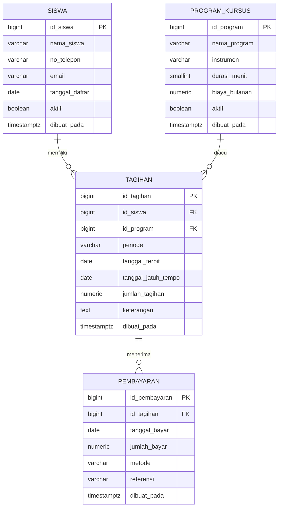

<div align="center">


# 🎵 Sistem Pendapatan & Piutang
### Salwa Music — Administrasi Kursus

**Sistem administrasi kursus musik berbasis web untuk mengelola data siswa, katalog program, tagihan bulanan, pencatatan pembayaran, dan pemantauan piutang secara real-time.**

<br>

<a href="https://yunistyasm.github.io/Sistem-Pendapatan-Piutang-Kursus-Musik-Salwa/">
  
</a>

<br><br>

[](https://www.postgresql.org/)
[](https://supabase.com/)
[](https://pages.github.com/)
[](https://developer.mozilla.org/en-US/docs/Web/HTML)
[](https://developer.mozilla.org/en-US/docs/Web/JavaScript)

<br>


</div>

---

## 👩‍🎓 Identitas Penyusun

<div align="center">

| | |
|---|---|
| **Nama** | **YUNISTYA SALWA MAHARANI** |
| **NIM** | 12030124120042 |
| **Mata Kuliah / Kelas** | Pengkodean dan Pemrograman / D |
| **Dosen Pengampu** | Dr. Totok Dewayanto, S.E., M.Si., Akt., CA |
| **Program Studi** | S1 Akuntansi |
| **Fakultas** | Ekonomika dan Bisnis |
| **Universitas** | Diponegoro |

</div>

---

<div align="center">

### 🎼 *"Musik yang indah, terkelola harmonis."*

</div>

---

## 📖 Tentang Proyek

**Salwa Music** adalah lembaga pendidikan musik yang menyelenggarakan kursus untuk 6 instrumen utama (Biola, Keyboard, Piano, Gitar, dan Vokal). Sistem ini dibangun untuk mengelola seluruh siklus keuangan kursus — mulai dari pendaftaran siswa, penerbitan tagihan bulanan, pencatatan pembayaran (termasuk cicilan), hingga pemantauan piutang secara real-time.

Proyek ini dikembangkan sebagai bagian dari mata kuliah **Pengkodean dan Pemrograman** dengan fokus pada implementasi basis data relasional (PostgreSQL/Supabase) dan integritas data keuangan.

---

## ✨ Fitur Utama

<table>
<tr>
<td width="50%">

### 📊 Dashboard
Ringkasan pendapatan bulan ini, total piutang, siswa aktif, dan program kursus tersedia dalam satu tampilan.

### 👥 Data Siswa
Manajemen identitas siswa terdaftar — nama, kontak, email, tanggal daftar, dan status aktif.

### 🎼 Program Kursus
Katalog 6 program musik dengan tarif bulanan, durasi sesi, dan instrumen.

</td>
<td width="50%">

### 📄 Tagihan
Penerbitan tagihan bulanan per siswa dan program, dilengkapi tanggal jatuh tempo.

### 💰 Pembayaran
Pencatatan penerimaan kas dengan metode Tunai, Transfer Bank, QRIS, atau Lainnya.

### 📈 Laporan
Rekap pendapatan, piutang berjalan, dan status tagihan (Belum Dibayar, Cicilan, Lunas, Lewat Jatuh Tempo).

</td>
</tr>
</table>

---

## 🎨 Tema & Desain

Sistem ini menggunakan palet warna yang mencerminkan identitas **Salwa Music** — profesional, hangat, dan elegan.

| Warna | Kode | Penggunaan |
|---|---|---|
| 🎨 **Navy** | `#142D4C` | Header, judul, tabel header |
| 🏆 **Gold** | `#BF9E5F` | Aksen, highlight, badge |
| 🌿 **Sage** | `#7A9478` | Status lunas, pembayaran diterima |
| ☁️ **Cream** | `#FAF8F4` | Background halaman |

---

## 🛠️ Teknologi

| Layer | Teknologi |
|---|---|
| **Frontend** | HTML5, CSS3, Vanilla JavaScript |
| **Database** | PostgreSQL (via Supabase) |
| **Hosting** | GitHub Pages |
| **Charts** | Inline SVG (custom) |
| **Auth (Rencana)** | Supabase Auth |

---

## 🗄️ Arsitektur Basis Data

### Diagram Relasi Entitas (ERD)



### Relasi Antar Tabel

| Relasi | Kardinalitas | Penjelasan |
|---|---|---|
| `siswa` → `tagihan` | **1 : 0..N** | Setiap tagihan milik satu siswa; siswa dapat punya banyak tagihan |
| `program_kursus` → `tagihan` | **1 : 0..N** | Setiap tagihan mengacu satu program; program dapat dipilih banyak tagihan |
| `tagihan` → `pembayaran` | **1 : 0..N** | Setiap pembayaran milik satu tagihan; satu tagihan bisa dicicil |

---

## 🎼 Katalog Program Kursus

| ID | Nama Program | Tarif / Bulan | Durasi |
|---|---|---|---|
| 1 | 🎻 Kursus Biola Pemula | **Rp 700.000** | 45 mnt |
| 2 | 🎹 Kursus Keyboard Lanjutan | **Rp 650.000** | 60 mnt |
| 3 | 🎹 Kursus Piano Pemula | **Rp 600.000** | 45 mnt |
| 4 | 🎹 Kursus Keyboard Pemula | **Rp 550.000** | 45 mnt |
| 5 | 🎸 Kursus Gitar Akustik | **Rp 450.000** | 45 mnt |
| 6 | 🎤 Kursus Vokal Dasar | **Rp 400.000** | 45 mnt |

> 💡 **Catatan:** Program **Keyboard Lanjutan** memiliki durasi 60 menit per pertemuan, sedangkan program lain 45 menit.

---

## 🧮 Logika Bisnis

### Formulasi Piutang

```
Total dibayar = SUM(pembayaran.jumlah_bayar)
Piutang       = jumlah_tagihan - total dibayar
```

### Kategori Status Tagihan

| Status | Kondisi | Deskripsi |
|---|---|---|
| ⚪ **Belum Dibayar** | Total pembayaran = 0 | Tagihan baru diterbitkan |
| 🟠 **Cicilan** | Pembayaran > 0 dan sisa > 0 | Siswa bayar bertahap |
| 🟢 **Lunas** | Sisa piutang = 0 | Tagihan terselesaikan |
| 🔴 **Lewat Jatuh Tempo** | Sisa > 0 dan tanggal > jatuh tempo | Menunggak |

> ⚠️ **Status tidak disimpan sebagai kolom** — dihitung dinamis dari agregasi pembayaran.

---

## 🛡️ Integritas Data

| Mekanisme | Implementasi | Fungsi |
|---|---|---|
| **Foreign Key** | `ON UPDATE CASCADE` / `ON DELETE RESTRICT` | Cegah hapus data master yang masih terpakai |
| **CHECK Constraints** | Nilai > 0, tanggal valid, metode standar | Validasi input transaksi |
| **Trigger** | `pembayaran_batasi_total` | Tolak pembayaran melebihi nilai tagihan |
| **Trigger** | `tagihan_batasi_nilai` | Cegah revisi tagihan di bawah total bayar |
| **Index** | Per siswa, jatuh tempo, per tagihan | Optimasi query laporan |

---

## 📊 Snapshot Data Live

**Per 1 Oktober 2026**

| Metrik | Nilai |
|---|---|
| 👥 Siswa Aktif | **13 siswa** |
| 🎼 Program Kursus | **6 program** |
| 📄 Tagihan Terbit | **13 tagihan** |
| 💳 Transaksi Pembayaran | **5 transaksi** |
| 💰 Total Tagihan | **Rp 7.300.000** |
| ✅ Pembayaran Diterima | **Rp 2.050.000** (28,1%) |
| ⏳ Sisa Piutang | **Rp 5.250.000** (71,9%) |
| 📅 Penerimaan Oktober | **Rp 1.050.000** |

---

## 🚀 Cara Menjalankan

### Prasyarat

- Browser modern (Chrome, Firefox, Edge)
- Akun Supabase (untuk koneksi database)

### Langkah Instalasi

```bash
# 1. Clone repository
git clone https://github.com/yunistyasm/Sistem-Pendapatan-Piutang-Kursus-Musik-Salwa.git

# 2. Masuk ke folder proyek
cd Sistem-Pendapatan-Piutang-Kursus-Musik-Salwa

# 3. Buka di browser
# Opsi A: langsung buka file
open index.html

# Opsi B: pakai Live Server (VS Code)
# Klik kanan index.html → Open with Live Server
```

### Konfigurasi Supabase

Edit file `config.js`:

```javascript
const SUPABASE_URL = 'https://xxxxx.supabase.co';
const SUPABASE_ANON_KEY = 'eyJhbGciOi...';
```

---

## 📁 Struktur Proyek

```
Sistem-Pendapatan-Piutang-Kursus-Musik-Salwa/
│
├── index.html          # Halaman utama aplikasi
├── style.css           # Styling tema (navy + gold)
├── script.js           # Logika aplikasi & interaksi
├── config.js           # Konfigurasi Supabase (URL + key)
├── database.sql        # Skema database & seed data
└── README.md           # Dokumentasi ini
```

---

## 🔒 Catatan Keamanan

> ### ⚠️ Penting — Lingkungan Demo/Internal
>
> Sistem ini saat ini dijalankan pada **lingkungan demo/internal**. Kebijakan Row Level Security (RLS) pada Supabase **diaktifkan namun sengaja dibiarkan terbuka** untuk keperluan pengembangan dan pengujian.
>
> Akses hanya diberikan kepada pihak internal dan **tidak dipublikasikan untuk penggunaan umum**.
>
> **Untuk penggunaan produksi di masa mendatang, disarankan:**
> - ✅ Menambahkan **Supabase Auth** dengan login untuk admin/staff
> - ✅ Mengganti kebijakan RLS berbasis **role** (Admin vs Staff)
> - ✅ Menerapkan prinsip **least privilege** pada akses database

---

## 🗺️ Roadmap

- [x] Skema database PostgreSQL
- [x] Dashboard & navigasi
- [x] CRUD siswa, program, tagihan, pembayaran
- [x] Perhitungan piutang real-time
- [x] Trigger & constraint integritas
- [ ] Supabase Auth + RLS berbasis role
- [ ] Auto-reminder WhatsApp/Email untuk jatuh tempo
- [ ] Export laporan ke PDF/Excel
- [ ] Backup otomatis harian
- [ ] Multi-user dengan log aktivitas

---

## 📚 Sumber Data

- 📄 `database/database.sql` — Skema & seed database
- 🗄️ Snapshot Supabase Salwa Music per **1 Oktober 2026**

---

## 📄 Lisensi

Proyek internal — **Salwa Music** © 2026

---

<div align="center">

### 🌐 Buka Sistem

<a href="https://yunistyasm.github.io/Sistem-Pendapatan-Piutang-Kursus-Musik-Salwa/">
  
</a>

<br><br>

**🎵 Musik yang indah, terkelola harmonis. 🎵**

<br>

<sub>Dibuat oleh <strong>Yunistya Salwa Maharani</strong> — S1 Akuntansi, FEB Universitas Diponegoro</sub>

</div>
